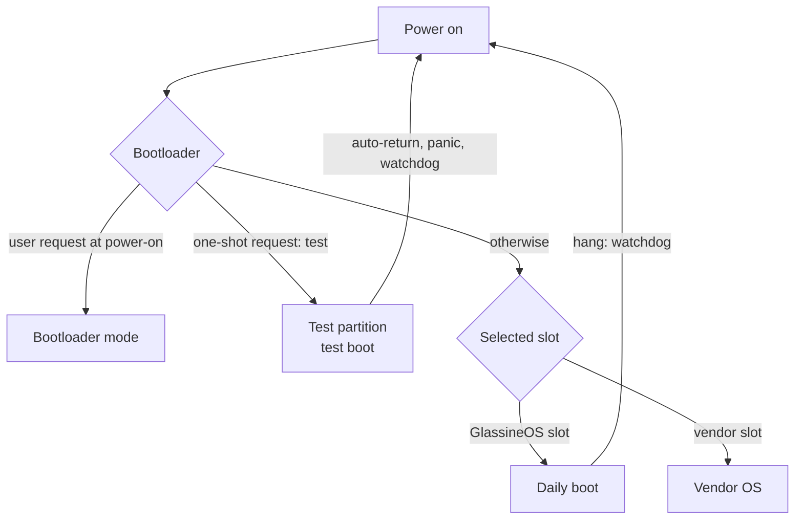

# Boot flow

How a GlassineOS device gets from power-on to the desktop. This page describes the
design shared by all devices. Each device page says how its bootloader, partitions and
hardware map onto it (for example [Note Air](../devices/onyx-noteair/index.md#how-glassineos-boots)).

## Purpose

- Start the system without a host computer, and without touching the vendor operating
  system kept on the device.
- Let a new kernel image be tried once, with an automatic way back, before it becomes
  the image that boots every day.
- Keep a crash log that survives the reset, so a failed boot can still be diagnosed.

## Design

### Overview

### Bootloader

The vendor's bootloader chain stays in place; GlassineOS only replaces or reconfigures
the last stage where the device allows it. From that stage GlassineOS needs:

- **Slot selection:** a GlassineOS slot and a vendor slot, and a way to pick the one
  that boots.
- **A one-shot request** that boots a second partition once (on Android devices, a
  reboot into recovery), cleared by the bootloader after reading it.
- **A way in without a working OS**, such as a key or sensor at power-on.
- **A role marker:** something on the kernel command line that differs between a normal
  boot and the one-shot boot, so the initramfs knows which role to play.

Boot image format, kernel command line and how each of these works are device facts and
live on the device page.

### One image, two roles

The same kernel image can sit in the daily boot partition and in the test partition.
Its initramfs decides which role to play from the role marker:

| | Daily boot | Test boot (one-shot) |
|---|---|---|
| Root file system | read-write | read-only, changes go to RAM |
| Services | full set | minimal (network, SSH, kernel modules, optional desktop) |
| Host computer needed | no | yes, it must confirm within the time limit |
| Writes the storage | yes | no |
| On trouble | watchdog reset | auto-return, panic, watchdog: all reboot into the daily boot |

### Daily boot

1. The initramfs mounts `proc`, `sys` and `dev`, reads the previous boot's crash log
   into RAM, and arms the hardware watchdog. The watchdog keeps running after the
   switch to the real root, so a kernel hang turns into a warm reset.
2. It waits for the root partition by its partition name, since storage may appear
   only after the initramfs has started.
3. It checks the file system the way a distribution does before mounting root
   read-write: automatic repair of safe problems only. If the check needs a person, it
   mounts anyway and logs the result.
4. It mounts the root read-write and saves the previous boot's crash log to
   `/var/log/pstore/`.
5. **Kit:** every kernel image carries the matching kernel modules and the newest
   device-specific files. The initramfs copies them onto the root file system when the
   image differs from the last one installed (an ID file records which), replacing the
   modules, because every build has the same kernel release string.
6. It hands USB over to the root file system and switches root to the init system
   (OpenRC).

If any step fails, the initramfs stays put and offers a shell over USB networking
instead of rebooting, because a reboot would only loop into the same failure.

**Deployments layout** (built and host-tested, untested on hardware): instead of steps
3 and 4, the initramfs first resumes or cancels a hibernated session. It then assembles
the root from a read-only base and the picked deployment's layers, and moves its mounts
into the new root before the switch. See
[Root file system and deployments](root-and-deployments.md#boot-steps).

### Early services

A boot service prepares the device before the rest of the system starts:

- Installs the kernel modules shipped in the kit, after device detection has finished,
  so modules whose order matters (radios, for example) load only when asked.
- Makes the device's firmware available from the vendor partitions. These are mounted
  read-only, without replaying a journal, so nothing is written.
- Copies unit-specific calibration once. It exists only on that unit and never goes
  into an image.
- Writes the kernel log to disk, so early crashes in a loop are not lost.
- Gives Wi-Fi a stable MAC address before the network manager starts.
- Starts device-specific helpers (radios, coprocessors) in the background.

Services that only apply to one kernel check which kernel is running and skip
otherwise. User data (`/home`, container storage, Flatpak apps) lives on a data
partition, outside the root image. The e-ink engine and the desktop session start last.

### Test boot

A test boot comes from the test partition after a one-shot request. It never writes the
storage.

1. Same start as the daily boot: crash log, watchdog.
2. Brings up USB networking (CDC-NCM, device at `172.16.42.1`, DHCP for the host) with
   a shell, a kernel-log endpoint and a script runner.
3. Waits for the host. Without a "stay" within 180 seconds, it reboots into the daily
   boot.
4. On request, starts the installed system read-only, with its changes in RAM. A
   watchdog feeder reboots unless the host confirms within 300 seconds.
5. On request, runs the **daily-boot path** from the test partition. This is how a new
   image's daily boot is tried before it is written to the daily boot partition: if it
   hangs, the watchdog resets and the next boot is the old daily image.

The kernel image itself sets `panic=5` and turns soft lockups, hung tasks and oopses
into panics. Every way out of a test boot is a warm reset.

New images go through this order: write to the test partition → test boot → daily path
from the test partition → write the same bytes to the daily boot partition → reboot and
check the daily boot. The old daily image is saved first.

### Crash log (pstore)

The kernel keeps its log in a reserved RAM region that survives a warm reset. Where the
vendor kernel uses such a region, GlassineOS uses the same address and layout, so each
kernel can read the other's log. The daily boot saves what it finds.

### Vendor kernel flavour

A fallback flavour boots the same root file system on the device's vendor kernel
instead of mainline. The kernel is the user's own, taken from their device and patched
to run the GlassineOS initramfs. GlassineOS never ships a vendor kernel.

## Interfaces

| Interface | Between | What |
|---|---|---|
| One-shot boot request | Linux → bootloader | `reboot recovery` (test partition), `reboot bootloader` |
| Slot selection | Linux / vendor OS → bootloader | which slot boots |
| Role marker on the command line | bootloader → initramfs | daily or test role |
| Kit ID file on the root file system | image → root | whether to reinstall modules and device files |
| `/var/log/pstore/` | initramfs → user | the previous boot's kernel log |
| USB CDC-NCM at `172.16.42.1` | device ↔ host | test-boot control, SSH on the running system |

## Open questions

- **Installed partition layout.** Devices run a development layout today.
- **Recovery.** Decided: the recovery partition holds the mainline recovery
  permanently, and new kernels get their test boot by kexec from the running system
  instead ([0010](../decisions/0010-root-and-deployments.md)). Until that works, kernel
  updates pause, and the test boot described above is a development flow only.
- **Updates.** Decided: deployments on read-only bases, each tried before it counts
  ([Root file system and deployments](root-and-deployments.md)). Not on devices yet.
- **Marking a boot successful.** Nothing does this yet, so the GlassineOS slot has to
  stay pinned where the bootloader counts retries. For deployments, a boot-success
  service accepts a candidate after a healthy boot (built and tested in QEMU, not on
  devices yet).
