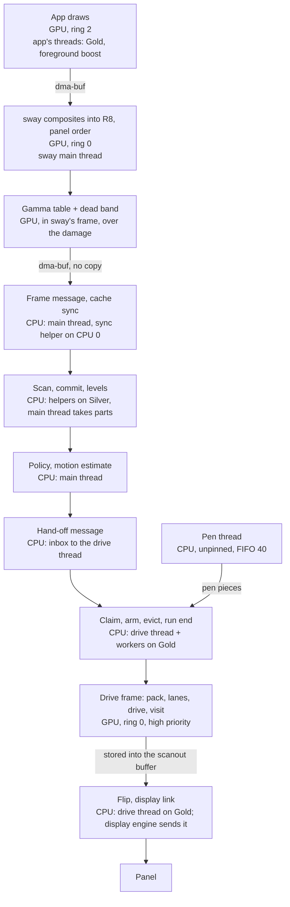

# CPU and GPU

Which part of the display path runs where, and why, on the Note Air. The daemon itself, its
modes and its options are on [E-ink engine](eink-engine.md); this page is about the
hardware, the split and the numbers.

!!! warning "Status"
    Device numbers are from one Note Air, under the conditions stated. **The source is not
    public yet**, and runtime names will change when it moves to its public repository.
    Written largely by AI agents, unreviewed. Treat the reasoning as a working record, not
    as expert analysis of this GPU.

    A date means *verified on hardware* that day. "From source" means read from the code,
    2026-11-01. Estimates say so. **Scripted touch scrolls didn't actually move content
    under sway until that was fixed on 2026-11-01**, so scripted "scroll" numbers from
    before that date describe an app's own activity, not a scroll. This page uses them only
    where marked.

## Purpose

- Keep a panel frame every 11.76 ms while apps also draw on the same GPU.
- Keep the CPU's part small, so the panel doesn't take the device's battery and fast cores
  with it.
- Record why each step sits where it does, so nobody moves it back without new numbers.

## Design

### The hardware

| Part | Fact | Verified |
|---|---|---|
| SoC | Snapdragon 636 (SDM636, sdm660 family) | 2026-09-27 |
| Gold cores | 4, logical CPUs 1–4, Kryo 260 Gold (A73 class), capacity 1024 | 2026-10-25 |
| Silver cores | 4, logical CPUs 0, 5, 6, 7, Kryo 260 Silver (A53 class), capacity 640 | 2026-10-25 |
| CPU clocks | both clusters capped at 1.4016 GHz (nominal point, open-loop voltage in our port). Gold steps 300, 1113.6, 1401.6 MHz | 2026-10-30 |
| Memory, Gold core | DRAM read 5.98 GB/s, write 8.89, copy 9.23 | 2026-10-25 |
| Memory, Silver core | DRAM read 1.97 GB/s, write 9.23, copy 3.77 | 2026-10-25 |
| GPU | Adreno 509 (a5xx), fused top clock 430 MHz; steps 160, 266, 370, 430 | 2026-10-11 |
| GPU rings | 4 rings with the CP firmware that supports it; the rings switch only between submits, unless a submit has yield points of its own | 2026-10-26 |
| DSP | no compute DSP, so no HVX to offload to. Only the modem and the audio/sensor DSP run; the power statistics' compute-DSP slot stays dead | power statistics, date not recorded |

Notes:

- **The logical CPU numbers do not follow clusters.** The kernel boots on a Silver core, so
  pin by `related_cpus` or capacity, never by index.
- **The Silver cores' weak read rate matters.** Reading is where most of the display's
  CPU work goes.
- **Rings are not independent GPUs.** All the work shares one GPU. A ring switch takes
  effect only when the running submit ends or yields, so what matters is how long other
  people's submits are.

### From app to panel

| Step | Runs on | Thread, cluster | Why there |
|---|---|---|---|
| App rendering | GPU | app, Gold when in front | apps draw with GL; the alternative is llvmpipe at about a core per drawing app |
| Composite to R8 | GPU | sway | see [the comparison](#cpu-versus-gpu). Rotated OVER on the CPU is the slow case by far |
| Gamma, dead band | GPU | sway | the frame is already on the GPU; a separate pass over damage. Frees 4 Gold cores from the table lookup |
| Read the frame | CPU | main, sync on Silver | the mapping is cached memory and needs one cache sync; nothing is copied |
| Scan, commit, levels | CPU | 4 helpers on Silver + main | decisions and bytes are branchy and small; the GPU has no way to return them quickly, and read-backs are expensive here |
| Policy | CPU | main | a state machine |
| Claim, run-end passes | CPU | drive thread + workers, Gold | per-pixel but rare; the GPU version was tried and lost ([below](#cpu-versus-gpu)) |
| Drive frames | GPU | ring 0 | the only per-frame, per-pixel, whole-panel work. 2.5–4× over budget on four Gold cores |
| Flip | CPU, little time | drive thread, Gold | a real-time deadline |
| Pen preview | CPU | pen thread | a few pixels; GPU raster for the pen was rejected in design, not measured |

### Why the split looks like this

**Decisions on the CPU, drive on the GPU.** What's settled once per update (which pixels go
where) runs on the CPU, and what runs every frame without choice runs on the GPU. They read
the same state: the packed planes `D`, `W` and `T` are system dma-heap buffers mapped by the
CPU and imported by the GPU, and each cache line has one owner at a time. A pixel's move
between the fast and the slow drive moves nothing. Built and proven on the device since
2026-10-29.

**No read-backs.** A compositing path that read a GPU result back for CPU stages was
twice as slow as doing it on the CPU ([dead end](../dead-ends/index.md#compositing-in-the-e-ink-engine-with-a-read-back)).
So the data flows from the GPU to the CPU only at the frame buffer sway hands over (cached
memory), and from the CPU to the GPU through shared state.

**The update job on Silver.** On Gold, the helpers and a boosted foreground app slowed each
other. The update scan doubled (2.5–2.7 → 4.5–4.7 ms) and the app's slow frames rose 2–3×,
most likely through shared L2 and DRAM rather than CPU time (2026-10-27, Chromium under a
scripted input). It didn't speed up on Gold in exchange. So the update job runs on Silver,
and that is the default.

**Why a full GPU engine isn't the target.** The claim on the GPU was 27–30 ms against
9.8 ms for one A53 (2026-10-04). A GPU-resident single state was probed and didn't fit
(full-panel GC16 mid-run 113–119 ms against the 12.5 ms budget, 2026-10-25). So the design
keeps decisions on the CPU.

### CPU versus GPU

Same job, both sides, where both numbers exist. Lower is better; ms per full panel unless
stated. Conditions vary: compare within a row.

| Job | CPU | GPU | Today | Measured |
|---|---|---|---|---|
| Composite to the panel | pixman copy 2.7; rotated copy 8.2; rotated OVER 37; exact grey composite 30 (A53 at 1.11 GHz) | R8 2.2–2.4; +2 per OVER layer (430 MHz) | GPU | 2026-10-11 bench |
| Gamma table over an R8 frame | one Gold core 3.85; four Gold bands 1.77 (+ a 1.4 ms sync) | 2.6 in the daemon's own pass; the pass in sway's frame not timed alone | GPU, in sway | 2026-10-26, 2026-10-11 |
| Daemon's read of a live frame (~2.45 Mpx damage) | CPU table, four bands 6.0; copy after GPU table 3.2–3.4; in place 2.0 | — | in place | 2026-11-01 |
| Stagger drive, A2/2, scroll | ctl 3 on planes: four Gold threads 31.5–50, one thread 89–161 | same rule on planes 15.6–17.6 (430 MHz); ctl 4's two-tier rule 1.75 for the drive, 2.5 for the whole pass, idle | GPU | 2026-10-30 (CPU), 2026-11-01 (GPU) |
| Per-pixel claim | one A53 9.8 | 27–30 | CPU | 2026-10-04 |
| Dizzy dots (a full window update) | 10.6–11.5 a commit on 4 threads | block form ~4× the CPU; layered form 232–417 for a full panel, with barrier faults on the A509 | CPU | 2026-10-14, 2026-10-16, 2026-10-24 |
| Non-staggered drive frame | about 28 of CPU | low: the daemon's CPU dropped 74 % when drive frames moved to the GPU | GPU | 2026-10-02, 2026-09-29 |

The two Stagger cells in the GPU column are not the same algorithm: ctl 4 defers payback to a
maintenance visit. It is the algorithm change plus the planes, not the GPU alone, that made
it this cheap.

On the CPU, ctl 4's twin is kept as the reference and the emergency fallback, not as a
production path.

### Frame budget and measurements

The panel period is 11.76 ms. The working budget for a frame's work is 12.5 ms, a target set
during design for full-panel motion at 42.5 steps per second. The period is what decides if
a frame is late.

**The real scroll: Nautilus full screen, 2026-11-01.** A scripted 60 s touch scroll with
proven motion (42 strokes), no extra GPU load, sway on GLES. Timers off unless stated.

| Measure | Value |
|---|---|
| Stagger frame, avg / max | 5.87 / 18.1 ms |
| Late panel frames | 4 of 4660 (0.09 %); with GPU timers on 8 of 4563 |
| The daemon's GPU work per frame (timers on) | 4.99 ms: pack 0.70, visit 0.28, drive 4.02 |
| The same drive, idle bench at 430 MHz | 1.75 ms on scroll content, 1.20 still, 1.57 window |
| Lanes + drive as two programs vs one | 3.08 vs 4.05 ms; stagger frame 6.06 vs 7.40 ms |
| GPU hangs | 0 hangchecks in that run |

The roughly 2× between the live drive and the bench isn't explained: the live clock, sway's
work interleaved on the ring, or both. It is not split yet.

**A hand scroll in Chromium is the hard case** (2026-11-01, `ahead_ms` 30): panel 58 frames
per second (gap p50 17 ms), 64 % of frames past the 11.8 ms slot, Chromium about 30 frames
per second, stagger frame 9.75 ms. The GPU contention is real here. No repeat after
`ahead_ms` moved to 23, which the maintainer preferred by feel.

**Run ends** (scripted load, real run ends; 2026-10-31 to 2026-11-01):

| Step | Value |
|---|---|
| Full-panel claim, 1 → 4 bands, p50 | 53.5 → 17 ms |
| Evict at run end, on the worker pool | 3.13 ms avg (max 3.51) |
| Takeover at run end | 10.65 ms avg (from 21.5 ms) |

**Soaks.** With the kernel fix below: 0 hangchecks in 32,288 stagger frames (10 min with a
foreground terminal printing and a synthetic GPU load), and 0 in 45,617 panel frames in a
second 10 min run with a real scroll. Before the fix, the same soak: 4 in 32,361.

### Where the CPU goes

Same real scroll, 2026-11-01. The daemon as a whole: **about 0.95 cores** (61.1 s in a 64 s
window: 4585 panel frames, 0 late, 2271 app updates).

| Thread | CPU time | Share | Per unit |
|---|---|---|---|
| Update helpers (4, Silver) | 22.3 s | 36.6 % | ~9.8 ms an app update |
| Stream / drive (Gold) | 13.4 s | 21.9 % | ~2.9 ms a panel frame |
| Main loop | 12.9 s | 21.1 % | ingest ~1.6 ms a frame, policy, the caller's update parts |
| Frame workers (Gold) | 10.0 s | 16.4 % | claim bands, update parts |
| A CPU-0 thread (inferred: the sync helper) | 2.4 s | | |
| Ingest pool, pen, Mesa | about 0 | | |

So the update job is the biggest item: about 43 % with its share of the main loop.

**The update job, by part** (2291 updates, 60 s, helpers on Silver, before `commit_skip`):

| Part | CPU per update |
|---|---|
| Scan | 5.13 ms |
| Commit | 4.23 ms |
| Levels | 2.54 ms |
| Total | 11.9 ms (caller's wall time 3.07 ms) |

`commit_skip`, on by default since: commit 4.2 → 2.6 ms, the daemon's total −7 %, same update
count (A/B off/on, 45 s each).

**Why the scan costs so much.** Per update the input is about 1.5 Mpx, of which only 7.3 % of
pixels really change, but 33.9 % get flagged: the shadow holds dots, so an unchanged grey differs
from its dot. Damage can't say which pixels changed, and the scan already reads damage only.

**dma-buf syncs:** about 2.3 % of the daemon's CPU, from one call a frame (0.32 ms avg). Not a
lever. The first estimate that made them look big was per run, in a run that lasted the
whole minute.

Two ideas to cut this further were measured or reviewed and stopped: see
[Dead ends](../dead-ends/index.md#e-ink-engine).

### App work against drive frames

The GPU is shared, and the wait is what hurts. A trace (2026-10-26, GNOME Software's own
activity, not a scroll) showed the GPU only 54–58 % busy, yet the daemon's drive submits took
4.6 ms of GPU and 12.8 ms from submit to retire (p90 about 30): they wait behind an app's
submit of about 10 ms on a ring that doesn't preempt mid-submit. A GTK4 frame was one 40–80 ms
job on 2026-10-11.

The controls, in the shipped order:

| Control | Default | Effect |
|---|---|---|
| High-priority daemon contexts | seeded | the daemon's work sits on ring 0; apps run on ring 2 |
| Apps in sysmem, no bins | seeded profile | GTK4 made faster; fastest of the tried defaults (2026-10-16) |
| Yield points inside app submits (Mesa, `FD_L4`) | on for apps, opt-out; not for sway or the daemon | a submit's batch is cut every 8 draws with a real switch point between. OpenMW (2026-10-26): the daemon's drive wait 10.3 → 8.3 ms avg, p90 ~14 → ~12; OpenMW itself −12 % in interleaved runs; about 100 switches a second with 0 faults across 3 runs |
| Short profile (sysmem, no yields) | Chromium | yields changed nothing measurable for Chromium, whose jobs are short |
| Split submits (Mesa `flush`) | opt-in | stagger frame 17.6 → 9.5 ms, the app about 13 % fewer frames and 30 % more CPU (2026-10-11, GNOME Software's own activity). `flush` alone made that app 2× slower |
| Chunked separate submits | opt-in | costs frame rate in most apps (OpenMW 56–58 vs 66–74 frames per second); off since 2026-10-16 |
| Early answers to sway (`ahead_ms`) | 23 ms | limits apps to 43.5 frames a second during runs |
| Latch (repaint waits for ready buffers) | seeded | the daemon's ingest 51.5 → 11.3 ms (2026-10-11, GNOME Software's own activity) |
| Foreground boost | seeded, 70 % floor | apps in front run almost wholly on Gold; Chromium's renderer main thread on Silver 12–22 % → 3 % of its time (2026-10-26, scripted input); no measured speed gain on a scroll, CPU-bound work and battery are unmeasured |

Rendering profiles are per app and set in settings. Chromium's Flatpak starts on `short`.

**Not a lever:** GPU clock (already at the fused top), more priority alone (the switch still
waits for the submit).

### Mesa and kernel constraints

Known A509 issues that shaped this, and what stands in for them. Patches are in our system
Mesa and kernel; the Flatpak GL extension has its own Mesa.

| Issue | Fact | Stands now |
|---|---|---|
| Ring switch only at submit ends | as above | yield points in app batches; short submits |
| **a5xx write-pointer race** | the preemption interrupt path could write an older `CP_RB_WPTR` after a submit's newer one, so the CP ran a whole lap of stale ring (`CP opcode error`, fences going backwards) | fixed in our kernel by taking the ring's preempt lock around the write (2026-11-01). Before 4 per 32,361 frames, after 0 per 32,288 |
| **Compute: `(jp)` on `end`** | a shader whose divergent branch goes straight to `end` leaves its waves unreconverged. The next *different* program hangs, across processes | fixed in our system Mesa with a nop before `end`, as newer upstream does (2026-11-01). The Flatpak Mesa already has it |
| **Timer queries** | a hang in the split drive was blamed on GPU timer queries, then withdrawn the same day: other causes above. 0 hangchecks with timers on, 2026-11-01. They still make the submit wait | timers are off in production and on for benches |
| **Lost wave** | under foreign GPU load an early compute wave of a dispatch could be lost, leaving a few wrong words in the first rows. On the fixed Mesa the canary is clean (0 bad of 640 frames, where 248–270 failed on 2026-10-30) | a workaround of leading workgroup rows of scratch stores stays, because removing it saves only about 0.02–0.03 ms a frame |
| **Workgroup shape** | an exact grid (59×4 for the drive and lanes) was chosen against the hang; re-benched on the fixed Mesa, no faster shape exists | stays |
| **Two programs vs one** | one program was the older guard; the two-program form is faster and clean on the fixed kernel | two programs are the code default, and require the kernel fix |
| **Barriers** | a 256-invocation workgroup with any loop before `barrier()` writes nothing, with no GL error (2026-10-04) | barrier passes stay at ≤ 128 invocations |
| **2D blitter** | texture uploads into a busy texture through the A509's 2D blitter wrote nothing (GTK glyph atlas: missing letters; 2026-10-16) | our Mesa takes the 3D path there |
| **Upload after image store** | uploads into a texture that is also an image-store target are lost | textures are upload-only or image-stored, never both; not assumed fixed by the Mesa fix above |
| **Chromium GPU hangs** | **open.** Chromium's GPU process hangs the GPU now and then; one dump shows a ring switch triggered and never completed, plus a bus error flag not decoded yet (2026-10-26). A fault with it as the offender also appeared on the fixed kernel (2026-11-01, cause unproven) | the session keeps working: the GPU resets, the stagger comes back, and at worst sway restarts on pixman |

### sway's renderer and the zero-copy paths

Sway runs a patched wlroots on GLES. Without GLES, sway has no `linux-dmabuf` and every GL app
falls back to llvmpipe, which was the largest CPU cost on the device before this design.

| Path | How | Copies |
|---|---|---|
| App → sway | linux-dmabuf | none |
| Sway's composite + gamma → daemon | cached heap buffer, single R8 plane, in panel order; held with `NEXT` until the next frame replaces it | none; one cache sync (2.0 ms on 2.9 MB) |
| Daemon ↔ GPU state | `D`, `W`, `T` as shared dma-heap buffers | none; range syncs |
| Stagger → scanout | image stores directly in the scanout buffer (`stagger_direct`, default on) | none. A copy variant: frame 15.4 vs 10.7–11.4 ms (2026-10-31, not on a real scroll) |
| Daemon → panel | a flip | none |

GBM buffers on this driver are write-combined; reading them on the CPU is too slow to use, and
reading the scanout mapping while streaming has over-driven the panel. See
[the warning on the device page](../devices/onyx-noteair/index.md#display-and-panel).

### Scheduling and clocks

**Thread priorities** are on [E-ink engine](eink-engine.md#process-and-thread-layout). The
reasons: the stream thread owns the deadline. Band work must not stall the stream. Helpers
must not stall the pen, so they sit one step below it, on the same cluster it often lands on.

**The main thread** is `SCHED_OTHER` on purpose. It runs nice −10 with a 1 ms EEVDF slice.
A/B under 8 busy loops in the desktop (2026-10-25, scripted input, late frames per 30 s):
13, 15, 19 → 7, 13, 10. The slice alone did nothing: the weight does it. Nothing changes with
idle CPUs.

**Scheduler energy awareness is off** (`sched_energy_aware`, 2026-09-29). Moderate load would
otherwise go to the cheapest core, a slow one.

**CPU floors.** The desktop's cgroup has a 60 % `uclamp.min`, except in saver mode: raises the
clock but doesn't move threads, since it still fits a Silver core. The foreground boost's
70 % does move them, since it no longer fits one (capacity 640 of 1024). Sway, the daemon and
the shell are never moved into the boost.

**Real-time threads and clocks.** `SCHED_FIFO` threads have `uclamp.min` 1024 by the kernel's
default, so schedutil runs their cluster at the top while they run (from source; the energy cost
of this isn't measured).

**Input boost.** With the power mode's `boost=150`, every CPU's minimum clock goes to the top
until 150 ms after the last input. `boost_run` (seeded) extends it during a run, up to 3 s after
the last input. One A/B recorded 23.8 vs 22.2 frames per second in
Chromium (2026-10-15, scripted input); another found no gain (2026-10-11). It's seeded under the
"fastest settings" rule, not for proven benefit.

**GPU clock.** The governor ramps far too late for a frame every 11.76 ms (43 ms frames without
help). So the daemon holds `min_freq` at the top, 430 MHz, while the link is up, and restores it at
link-down. A restore after a crash is safeguarded: a saved minimum that's already at the top
restores to the lowest step instead.

**DDR clock.** A CPU-to-DDR vote table, by the power mode: performance (the default) adds a floor
of 5163000 kbps while awake (from source). Saver uses a lower table.

**Wakeup latency.** `qos=global` holds a CPU wake latency of 0 while the link is up: WFI only on
all CPUs. `cpu:N` is the narrower option.

### Power trade-offs

Nothing above has a full battery A/B. What is known:

- The panel's refresh is active compute, so a run costs real power, and the link's cost at rest
  is limited by the holds: 2 s of link, 400 ms of rails, 30 s of a warm pipe.
- Desktop idle: 0.413 W with Wi-Fi on, 2026-09-29 (first baseline, on an older image and without
  the GPU path).
- Moving the gamma table to the GPU was meant to let the four Gold cores stay at lower clocks during
  updates. Its battery gain isn't measured.
- GPU clock hold, the wake-latency hold, the boosts and the DDR floor all favour speed. Owed: battery
  A/Bs of the foreground boost and of these holds. Seeded defaults aim for the fastest result
  today; a saver mode exists and turns the boost and floors down.

## Interfaces

Between CPU and GPU, the protocol to sway is on
[E-ink engine](eink-engine.md#frame-sources-and-the-buffer-protocol). The rest:

| Interface | Owner | What |
|---|---|---|
| Daemon's GPU state | daemon | `D`, `W`, `T`, ack plane: heap buffers; layout private to the daemon |
| Check modes | daemon | `gpu=check`, `stagger=check`, `ingest=check` compare CPU and GPU results |
| Apps' render profile | settings app | `gpu`, `short`, `cpu` per app. Env per launch path (drawer, D-Bus, Flatpak) |
| Foreground boost | session | a percentage in a flag file; off in saver |
| Power mode | session | `performance`, `balanced`, `saver`: DDR, CPU floor, input boost, touch controller timeout |

## Open questions

- **Chromium GPU hangs:** cause unknown. A fresh dump on the fixed kernel is the next step.
- **Chromium scroll:** 64 % of frames late on a hand scroll. Whether this is the daemon's arrival
  work or waiting behind other GPU work isn't split for Chromium.
- **Live drive vs bench:** the 2× isn't explained.
- **Update job:** the largest CPU item. Open: less scan work. See [Dead ends](../dead-ends/index.md#e-ink-engine) for what was tried.
- **Battery:** no A/B for the current defaults during use.
