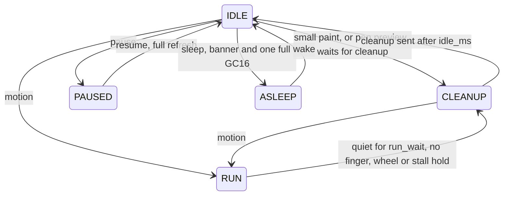

# E-ink engine

The daemon that owns the e-ink panel: what it reads from sway, how it decides what to
refresh and how, and how it computes every frame the panel sees. How the work splits
between CPU and GPU, with timings, is on its own page:
[CPU and GPU](cpu-gpu.md).

!!! warning "Status"
    **Source not public yet.** The daemon and its sway patches live in a private
    repository and will move to a public one; this page has nothing to link to. Runtime
    paths and names (the config file, the control FIFO, the session's flag files, some
    binary names) **will change at that move**, so this page uses neutral names:
    "`eink.conf`", "the control FIFO", "flag file".

    Written largely by AI agents and not reviewed by anyone who knows this hardware or
    these subsystems well. Numbers are from one device, a Note Air.

    Dates below mean *verified on hardware* on that day. A statement without a date is
    *from source, untested as stated*, read from the code on 2026-11-01. "Host" means
    the test ran on a PC, not on the device.

## Purpose

- Show what the desktop draws on a panel that has no controller of its own.
- Pick, per update and per pixel, a drive that fits the content: exact greys for a page
  at rest, fast black and white for motion, no flash unless it clears something.
- Keep the panel's charge balance honest while doing that: fast partial drives owe the
  ink something, and the engine tracks and pays it.
- Never miss a frame because an app is busy. On this panel, a late frame is late ink.

The live target is the mainline kernel, sway and the GPU path described here. Other
session types still present in the code are obsolete and not described.

## Design

### The panel as a software TCON

The Note Air has no e-ink timing controller chip
([device page](../devices/onyx-noteair/index.md)). Each frame that goes over the display
link says, for every pixel, drive to white, drive to black, or don't drive. A visible
change is a sequence of such frames, and a *waveform* is a table of those sequences. The
frames are computed on the SoC at about 85 frames per second, one every 11.76 ms
(p50 11.77 ms measured, 2026-10-25). So:

- **Refresh is computation.** There is no "submit, then idle while the controller
  works". While anything is changing, a frame is due every 11.76 ms, and the job has a
  hard period, like audio.
- **A late frame is visible.** It flips at a later tick. The engine counts it as late,
  not as a fault. A link that stalls with high voltage up is a fault:
  [the device page's list](../devices/onyx-noteair/index.md#display-and-panel) has the
  rule and what to do instead.
- **The engine can do what no fixed controller does:** per-pixel start times, its own
  drive rules, pixels that stop mid-waveform. The stagger below only exists because of
  this.
- **Ink lags the voltage.** Particles need about two frames of drive before a change
  shows (panel lab runs, as recorded 2026-10-14: one black frame from white still reads white,
  two read faint, three read clear).

### What the daemon owns

- The panel link and rails through the kernel's panel driver: when they are up, warm or
  down. It keeps the link up 2 s after input (`keepalive`), lets the rails drop after a
  400 ms linger, and keeps the display pipe warm for 30 s more (`link_warm`).
- The waveform file, read from the device (never shipped), and the temperature it is
  looked up at (the battery's: the panel has no sensor).
- What the panel currently shows: the shadow, the per-pixel levels, each pixel's position
  and charge record.
- The refresh policy.
- The pen's direct preview, ahead of the app.
- The GPU top clock while the link is up.

It does not own windows, input routing or composition: those are sway's.

### Process and thread layout

One process, running as root and started by the session script next to sway and seatd.
It listens on a Unix socket for sway's backend and outlives it. If it restarts, it
restores the panel's levels from a file it keeps under `/run` instead of assuming a
blank panel. `reexec` replaces the binary without ending the session.

| Thread | Scheduling | Runs on | Does |
|---|---|---|---|
| Main | `SCHED_OTHER`, nice −10, EEVDF slice 1 ms | unpinned | socket, damage, ingest, policy, the caller's part of the update job |
| Stream (drive) | `SCHED_FIFO` 51 | Gold, pinned | applies hand-offs, claims, submits GPU frames, flips |
| Frame workers | `SCHED_FIFO` 50 | Gold, pinned | claim bands, run-end passes, CPU render when the GPU is off |
| Pen | `SCHED_FIFO` 40 | unpinned | reads the pen, stamps preview ink, sends pen pieces |
| Update helpers (4) | `SCHED_FIFO` 39 | Silver (`update_cpus=silver`) | scan, commit and levels of an update, in parts |
| Sync helper | | CPU 0 (Silver) | dma-buf cache syncs off the main thread (`ingest_sync=on`) |
| Ingest pool | | CPUs 1–4 (Gold) | bands of a CPU grey convert or gamma table, when one is needed |
| Dizzy workers | | up to 8 threads, the 4th on Silver | only with `dither_pattern=dizzy` |

The stream thread is above its workers, and the pen thread is above the update helpers,
so a helper on the pen's core never delays ink. Why each thread sits where it does:
[CPU and GPU](cpu-gpu.md#scheduling-and-clocks).

### Frame sources and the buffer protocol

The panel is a wlroots output of sway, through a small output backend patched in. No
screen capture: sway renders into buffers, and the backend hands each buffer's file
descriptor to the daemon once, then only says "buffer N is the new frame, these
rectangles changed". The socket is `AF_UNIX`, `SOCK_SEQPACKET`, one message per packet.
The daemon listens; the backend connects and retries.

**Pacing.** The backend gives sway the next frame event only when the daemon answers.
Apps draw at the pace the panel can take.

| Message | Direction | Meaning |
|---|---|---|
| `HELLO` | sway → daemon | first on a connection: a capability mask |
| `BUF` / `DMABUF` | sway → daemon | a shm or single-plane dma-buf, with size, stride, format, modifier; the fd by `SCM_RIGHTS` |
| `DROP` | sway → daemon | that buffer is gone |
| `FRAME` | sway → daemon | buffer id, sequence, up to 32 damage rects; format field = the gamma table's tag; offset field marks a true frame |
| `CURSOR_IMG` / `CURSOR_POS` | sway → daemon | the pointer's sprite and position; the daemon paints the pointer itself |
| `DONE` | daemon → sway | frame no longer read; the next may come |
| `NEXT` | daemon → sway | the next may come, but this buffer stays locked until its `DONE` |
| `LUT` | daemon → sway | the 256-entry gamma table and its tag (a hash of the bytes) |
| `BAND` | daemon → sway | dead band T and the quiet gap |

Capabilities in `HELLO`: `NEXT` (hold a frame), `LUM` (grey by luminance), `GAMMA`
(table on sway's GPU), `BAND` (dead band). An older peer sends or understands fewer, and
each side falls back.

**Grey R8 output.** With sway on GLES, the output buffer is single-channel R8, already in
panel order (a 270° output transform), and every GLES shader writes grey instead of
colour. This is a wlroots patch. The grey is true luminance by default (`grey=luminance`,
so saturated colours keep their lightness); `grey=luma` is the older integer luma. Sway
takes the formula at its start. Host: bit-identical panel against the colour path, on
terminal text and ANSI colour. Device: `ingest=check` 0 pixels different over 116
frames (2026-10-11).

Sway renders into cached system dma-heap buffers, not write-combined GBM buffers, so the
CPU can read them at full speed (seeded `sway-heap` flag). If that fails it falls back to
GBM by itself.

**Gamma on sway's GPU.** The panel shows 16 levels, and the default curve
(`gamma=1.8`) darkens light UI greys into visible levels. The curve isn't linear, so it
can't sit in the per-draw shader: translucent pixels and blended edges would come out
wrong. A final pass over each frame's damage writes through the table, as a 256×1
texture. The daemon then knows from the tag that the bytes are final. Still scene,
device, 2026-11-01: the panel byte for byte equal to the daemon's own CPU table
(199 levels). A frame carrying a different tag isn't read; the whole-picture frame
follows. On pixman there is no such pass, and the daemon applies the table itself.

**In-place ingest (hold a frame).** When a frame is tagged with the daemon's table and
the backend can hold frames, the daemon doesn't copy it. One whole-buffer cache sync
(`START|READ`), then every reader uses the mapping with its stride, and the frame is
answered `NEXT`; its `DONE` goes out when a newer frame replaces it. Anything that would
write into the source first copies the view back. Device, 2026-11-01: `shot` panel equal
with the view on and off; no copy-backs in 1404 frames. Switch: `ingest_view`, default on.

The daemon also converts lazily (`lazy=on`): a frame replaced before anything needed it
is answered `DONE` unread, and its damage rides on the newer one, whose buffer holds the
whole picture.

**The true frame.** With the dead band on (below), a frame may hold greys that are
slightly off. After a quiet gap of `idle_ms / 2` (125 ms) the backend redraws what the
band may have held, without the band, and sends one `FRAME` marked true. It carries no
new content, so it is **not damage**: no burst, no run, no motion measure. The main loop
compares it with the panel at level precision and hands what differs to the cleanup. So
the cleanup paints exact greys and still keeps its timing (host: true frame 127 ms after
the last burst, cleanup at the same delay as with T 0).

**Answering early.** In a motion run the daemon may answer before reading (`ahead=predict`,
the default), so the next frame arrives just as it is needed. `ahead_ms` limits it to one
early answer per 23 ms: at most 43.5 app frames per second, which matches A2/2's
42.5 steps per second.

**Latch.** With the seeded `sway-latch` flag, sway's repaint waits (at most 50 ms) while
an app's GPU job is still writing a buffer it committed, so neither the composite nor the
daemon's read queues behind the app. The commit itself isn't held; an earlier version did
hold it and left Chromium with stale tiles.

On **pixman** (the fallback), frames are portrait XRGB in shm buffers, and the daemon
converts and rotates on the CPU.

### Scan, commit, the shadow and levels

The daemon keeps three things per pixel in panel order:

- **The shadow:** the 8-bit grey the panel is supposed to show or, in a run, the dot the
  commit chose. It lives on the CPU.
- **Levels:** 16 visible levels are the top nibble of the grey. Internally levels use a
  range up to 30, even numbers only (odd ones mark a pixel with payback owed).
- **The engine's state:** three packed planes in shared memory. `D` holds the cold word
  (level, position, stale, pulse count, charge record, 4 bytes), `W` the drive word (slot,
  target, level, 2 bytes), `T` the target plus request bits (1 byte). This is
  `@claim_state=packed` and `@stagger_state=lanes`, the daemon's default since 2026-10-29.

An update, for a burst of damage:

1. **Scan** the damaged rectangles against the shadow at level precision. For each 32 px
   tile it finds the first and last change. A repaint that changes nothing costs one
   scan and no drive.
2. **Motion estimate and policy** (below) choose how this burst paints.
3. **Commit** writes the new bytes into the shadow, by the policy's choice: exact greys,
   dithered dots, thresholded black and white, or four-level dots for DU4. With
   `commit_skip` (default on) a dithered commit only writes the tiles the scan flagged.
4. **Levels:** the targets are made from the shadow and handed to the stream thread as a
   message, so the main thread never waits for the stream lock (`handoff=inbox`, default).

Large updates (from 0.25 Mpx) run scan, commit and levels in parts on the update helpers
(`update_job=pool`, default); the bytes don't depend on who ran what.

On the stream thread, a **claim** decides per pixel what happens to a new target: who
owns it, whether it preempts, how long a matched cut drives. Claims of at least 0.3 Mpx
split into row bands on the workers (`claim_bands=4`, default). A full-panel claim at a
run's end: 53.5 → 17 ms p50 with four bands (2026-11-01).

### The refresh policy

The policy is a pure state machine: no clock, no I/O, fed events with the current time,
returning actions. The same code runs in host scenario tests and trace replay.



A burst is not a state. One decision table picks one row for it. In order:

| Row | When | Paint |
|---|---|---|
| Popup | a popup or menu mapped within 1 s | a dithered fast drive at once, the GC16 partial of its real greys right behind; no flash of the rest |
| Popup gone | a popup unmapped within 1 s, no contact | one GC16 partial of what it uncovered |
| Ink redraw | an app re-rendering what the pen just inked, within 1 s | a fast drive; exact greys later, as ink debt |
| Run | a measured shift, a drag, a `fast` app, busy content, a GC16 just in flight under new change, or an open run | A2/2 with payback (below) |
| Press | finger down, not yet a gesture | the run's paint (A2/2), **without** starting a run, so a tap's result doesn't turn into a fast drive |
| Still floor | the app has its own paint range | that range's low end |
| Tail / page / shell | large change right after a run's end, an app with `pages=`, or the shell's own surfaces | GC16 partial, no flash |
| Flash | ≥ `flash_min` (35 %) of the screen | a flash clipped to the window; changes outside it get a GC16 partial |
| GC16 | wider than `du_max` (3 %), or a `quality` app | GC16 partial |
| DU | the rest | a fast drive, remembered for cleanup |

The states' timing rules:

- **Debounce.** A still screen's first damage (nothing painted for 500 ms,
  `debounce_gap`) waits up to 150 ms (`debounce_ms`, also the cap) for the rest of a short
  transition, so it paints once. Not during a drag, a wheel scroll, a popup's paint, right
  after pen ink, or with the on-screen keyboard up. Damage within 100 px of a tap in the
  last 300 ms and the shell's surfaces go at once. Chosen by eye, 2026-11-01.
- **Idle.** `idle_ms` (250) after the last damage, the cleanup runs. Small ongoing motion
  doesn't hold it back: when the area still changing is 4× smaller than what waits for
  cleanup, the cleanup goes ahead (`clean_motion`). A ticker can't block the screen.
- **Run end.** A run waits for the app's own frame gap, not a fixed time: 1.5× the largest
  recent gap, at most 1200 ms (`run_wait`, `run_wait_max`), never less than `idle_ms`,
  never with a finger down. A wheel event holds it 1 s (`wheel_hold_ms`); a stall of an
  app that last moved fast holds it 1 s (`stall_ms`).
- **Busy content.** Six bursts in 2 s covering ≥ 3 % of the screen (`busy`) count as motion
  like a finger: video keeps its run without a touch. Host-tested.
- **Run tail.** For 2 s after a run's end GC16, a frame without motion restarts no run;
  three large frames in a row less than 150 ms apart end the tail (continuous content).
- **Quiet.** `quiet_ms` / `quiet_after` limit updates when no input came for a while. It's
  off on this engine (`quiet_ms=0` is set when the engine opens) because an engine submit
  costs microseconds. An `eink.conf` line can turn it on; dense large damage lifts it.
- **Window changes.** A window mapping, unmapping, moving or resizing marks its area.
  Whatever changes there next gets one local flash at the cleanup, since the partial that
  showed it leaves the ghost of what it replaced. Bursts within 1 s of a window change
  never start a run.
- **Ghost accounting.** Each 32 px tile counts fast drives since its last flash. Cut A2
  counts double. At 30, the tile gets a clearing flash at the next cleanup.

**What a run's end does.** A run ends in one GC16 over what it touched inside the window
it started in. If the run used cut A2 (the default paint, so nearly always) or the area is
ghosted, it's a flash of just that area, and the engine drives only the pixels that need
it. Otherwise it's a partial GC16. That GC16 restores real greys.

### Motion estimate

Two kinds of evidence meet in one estimate:

- **The finger:** down or up, positions, a second finger. Travel of 2 % of the screen
  height makes it a gesture.
- **The content:** per burst, did the changed area *shift* against what the panel shows?
  A scroll's first frame shifts, whatever the finger did. A tap's repaint doesn't. Two
  shifted bursts within 300 ms start motion with no finger at all (a fling's tail, the
  wheel, an animation).

The states are still, press and moving. Moving latches until neither evidence came for
500 ms. Speed comes from the content when it was measured, otherwise from the finger.

`motion=adaptive` also fuses that speed into a damped log-space estimate, with hysteresis,
and can move the paint along a ladder as speed rises: GC16, DU4, A2, A2/8, A2/6, A2/4,
A2/2. **The engine's default doesn't use the ladder:** at start it sets
`motion=adaptive mmin=a2_2 mmax=a2_2`, so one paint for any motion, fixed A2/2 with
payback. The ladder remains available through `mmin`, `mmax`, `ladder` and per app through
`paint=`.

### Refresh modes and waveforms

The waveform file holds the panel's drives per temperature range. Lengths at 24 °C, as
read from it:

| Mode | Frames | About | What it does | Used for |
|---|---|---|---|---|
| GC16 | 38 | 0.5 s | 16 greys, exact; walks every driven pixel through its greys | still paints, cleanups, run ends |
| DU4 | 24 | 0.3 s | 4 greys | a ladder step only, not the default |
| DU | 22 | 0.26 s | black or white | small changes without a pure black-and-white source |
| A2 | 10 | 0.12 s | black and white only, one phase for all its drive frames | small changes; `a2=on` uses it where every changed pixel is black or white |
| A2/n | n | n × 11.76 ms | A2 **cut** to n frames, the last one idle | motion |

**Cut A2 rungs.** Because the engine computes frames itself, it can stop an A2 early.
A2/8, A2/6, A2/4 and A2/2 (`steps=`, default 8, 6, 4, 2) are cut lengths. A2/2 is one drive
frame plus an idle frame: faint, and fast. A cut leaves a pixel short of its rail, so the
engine tracks how far (next section).

**Flash vs partial.** A partial GC16 skips pixels whose level doesn't change. A flash
drives every pixel of its area, which clears ghosts and costs a visible blink.

**Payback, in the panel-model engine.** Every cut A2 runs with these on (`payback=on` sets
them together):

- **Panel model** (`model=panel`): per pixel, how far it is from each rail in frames, 0 to
  R, where R is the uncut A2's net drive.
- **DC record:** per pixel, the net drive so far.
- **Matched cuts** (`matched=on`, `matched_cap=3`): a pixel going to the other rail drives
  the longer of what it needs and what the record owes against it, at most 3 frames past
  its need.
- **Preempt** (`payback=preempt`): a paying pixel whose content changes takes the new step
  at once.
- **Heal** (`heal=2`): idle black or white pixels at least 2 frames short of their level
  get a few frames toward it, without holding up a step.
- **Snap** (`snap=on`): GC16 and DU start a black or white pixel from where the model has
  it, instead of swinging it the whole way.

### The stagger

A cut A2 step made staggered: every pixel takes its steps on its own frames. A pixel
belongs to one of G phase groups, by a 64×64 blue-noise rank map, and may start a step on
the frames where `frame mod G` equals its group. So 1/G of the panel takes the newest
content on every frame. The panel samples motion at the frame rate whatever the cut, and
the work per frame is even. It runs on the GPU. On at the first cut step of a run, off at
the run's cleanup, or 250 ms after targets last changed (`stagger_linger`).

**Controllers.** `stagger_ctl`:

| Ctl | Rule |
|---|---|
| 0 | fixed steps of n frames, staggered |
| 1 | drives toward the target while the panel model is short of the rail |
| 2 | ctl 1 plus payback through the idle slots. Kept, not recommended: no measurable DC gain, −16 % app frames (2026-10-11) |
| 3 | a **pulse instead of the idle frame**: a step may drive its whole cycle, reversals too, up to K pulses without an idle (`stagger_k`, 8). White to black in 10 frames instead of 17 |
| 4 | **ctl 3's steps on GPU bit planes**, the seeded default |

**Ctl 4, bit planes.** State per pixel becomes separate bit planes over 32-pixel words, so
the shader works on a word at a time. Only the parts that decide a frame's drive run every
frame:

- **Pack:** targets into the plane form, where they changed.
- **Lanes:** a pixel's *lane* is the GPU's while it's armed. A pass takes armed lanes from
  `D` and, on an eviction, writes them back and acknowledges. It returns at once where a
  word has no request.
- **Drive:** the per-frame decision and the wire output, stored directly into the scanout
  buffer.
- **Visit:** the charge record lives apart, and payback is settled in a maintenance visit
  that reaches 1 in 4 rows per cycle (deferred at most about 100 ms). The record saturates
  at ±127 frames instead of ±30000.

It needs G 2, the panel payback rule, a cap ≤ 3 and a layout repeating every 64 rows.
Otherwise ctl 3 runs, and the log says so once. GPU and CPU twin agree: 1920 frames, 0 bad
per run, 6 runs at 3 GPU load levels (2026-10-31). On the A509 it costs 2.4× less GPU than
ctl 3 under blue noise (2026-10-31, 6.4 vs 15.5 ms, not on a real scroll; see
[CPU and GPU](cpu-gpu.md#frame-budget-and-measurements)). The look differs in small ways
from ctl 3 (deferred payback, saturating record); no study of those has been done beyond
the eye.

The motion paint stays **black and white**: the stagger itself never dithers. It takes the
commit's dots. A controller over greys (motion greys as cut A2 steps) was tried and
shelved; see [Dead ends](../dead-ends/index.md#motion-greys-as-cut-a2-steps-a2grey).

**Payback in the stagger** (`stagger_pay=panel`, seeded). One rule with the engine: a pixel
at a rail starting a step toward the other rail owes
`b = min(max(owe − need, 0), cap)` frames past its need. Nothing is paid at an idle rail.
Cap default: `matched_cap` (3).

**Panel accounting.** The same model and record move with every drive frame, in the
engine and in the stagger. At a run's end, state goes back to the engine's words without
a crossing copy: the evicted lanes write `D`, the engine takes over from there.

**Rail hammer** (`hammer_top`, default 2). A pixel arriving at black or white from a grey,
or from a reversal (a partial history), gets 2 frames past its need into the rail. This is
an optical reset, not DC payback: the record never decides it. In ctl 4 it's a floor set
at the arrival.

**Layouts.** `stagger_stripe=0` (seeded, blue noise) is the rank map. `64`, `blocks`,
`cells` and `wbayer` are cheaper shapes for ctl 3; in ctl 4 the layouts cost nearly the
same, so blue noise stays. Blue noise was the maintainer's choice by eye, 2026-10-31.

### Dithering and the grey dead band

The commit turns greys into black and white for a fast paint. The motion paths use an
ordered threshold; black and white stay fixed.

| Pattern | Set by | Where | Notes |
|---|---|---|---|
| Blue noise | default | CPU | 64×64 threshold table, transposed and shifted against the stagger's groups, so the two don't line up |
| Bayer | `dither_pattern=bayer` | CPU | 8×8, a visible grid |
| Dizzy | `dither_pattern=dizzy`, or per app | CPU workers | error diffusion in a random order (Liam Appelbe's method), 8 layers of a 64×64 tile in motion. Commit 10.6–11.5 ms (2026-10-14) |

An app's own `dither=` wins. On the GPU, dizzy's correct block form is about 4× slower than
the CPU on the A509 (2026-10-24), so `dizzy_where=cpu` stays the default.

**The dead band** (`deadband=T`, 0 to 16). In sway's gamma pass, a pixel keeps its last
accepted grey while `|new − accepted| < T`. The accepted picture is the last R8 target
itself, so there's no extra texture. Slow drift still gets through in steps of T, and
small flicker doesn't. Dither dots read the whole byte, so a held byte holds its dots. The
error is below T and ends at the [true frame](#frame-sources-and-the-buffer-protocol).

| Evidence | Result |
|---|---|
| Host, one real clip (720p, 30 fps), T 0 / 4 / 8 | dizzy dots changing per frame 6.64 / 4.79 / 3.75 %; blue-noise dots 1.05 / 0.89 / 0.76 %; tiles barely change (97 → 95 %) |
| Host, slow rendered gradients | tiles 54 / 39 / 24 %; through a codec, 9.5 → 3.9 % at T 4 |
| Host, exact greys | T 0 byte-identical to the build without it; worst error 3 at T 4, 7 at T 8; true frame equals T 0's frame byte for byte |
| Device, 2026-11-01, T 8 | load gate under a scripted scroll and a synthetic GPU load: 0 faults, panel equal to source at levels after cleanup; the daemon's render + copy about 0.3 ms higher at the lighter load, equal at the heavier; 6 minutes, one app |
| Eye, 2026-11-01 | T 4, 8 and 16 tried on the panel; T 8 chosen, seeded |

Not done: real video on the device, a soak, Chromium, T 4 under load. T 12 and T 16 have no
host test.

### Pen path and brushes

The app's stroke would come too late for ink, so the daemon draws a preview itself, on a
`SCHED_FIFO` thread that reads the digitizer directly and sends small pieces straight
into the engine.

- **Ink areas.** The pen inks only where an app accepts it. Sway computes, per window, its
  visible part minus everything above it, and writes those regions to the daemon. The
  daemon holds a mask of 8×8 px cells, and the pen thread tests each point in constant time.
  A pen down outside the mask isn't inked; the app gets the pen as usual.
- **Sources of areas:** a small Wayland protocol, `set_areas`, per surface; a GTK module for
  known canvas widgets (not in Flatpak apps); accessibility discovery; last resort `ink=on`
  on an app's line, for its whole window.
- **Brushes.** Per app `brush=` and `eraser=` (width range and pressure exponent), or an
  app's own via the protocol. Version 3 brushes are declarative files sway writes,
  content-addressed by hash; the daemon validates every field and stamps them on the pen
  thread (hardness, spacing, tilt, velocity, textured tips, grey, opacity). Rnote Ink uses
  them. Device 2026-10-14: solid, marker, textured and split eraser.
- **Cleanup.** A stroke doesn't cost a GC16 (`ink_clean=damage`): the app's own content
  replaces the preview by a fast drive, and its greys wait as *ink debt* for one GC16 partial
  once the pen rested 3 s and the debt covers 15 % of the screen's tiles, or a tile has been
  driven 15 times. Any other GC16 over it clears the debt.

Latency floor, **an estimate, not a measurement**: about 40 ms to a faint trace and 51 ms
to clear ink (digitizer ~4, waiting for a frame ~6, row scan 0–11, ink ~23.5). The
measurement end to end has not been done.

### Per-app profiles and hints

`eink.conf` has one line per app: a lower-cased substring of the app id (Flatpak apps:
their Flatpak id), or `*` for all others. First match wins. The profile of a burst is the
app under its largest changed area.

| Key | Values | Effect |
|---|---|---|
| `mode` | `auto`, `quality`, `fast` | own repaints: sized, always GC16, or always fast |
| `touch` | same | during a gesture |
| `paint` | `LO-HI` or `STEP` | own run range, e.g. `a2-a2_4`; `LO == HI` = one mode, no cleanups |
| `curve` | `on`, `off` | with `paint=`: follow speed, or any motion at HI |
| `busy` | `auto`, `on`, `off` | own repaints count as motion |
| `motion` | `always` | every repaint is a run; for games, so a slow scene stays fast |
| `pages` | `on`, `off`, N | an app that replaces its page: only a measured shift is motion; a change is a GC16 partial, every Nth (`on` = 6) a flash |
| `dither` | `blue`, `bayer`, `dizzy`, `off` | own pattern |
| `ink` | `on`, `off` | the pen, see above |
| `brush`, `eraser` | width | the pen preview |

KOReader (`luajit pages=on`) is seeded. Sway also passes hints that aren't per-app settings:
popups map and unmap, window changes, tile-handle drags, on-screen keyboard state, ink
regions. The shell's own surfaces count as *calm*: never a press, never a run, large changes
without a flash.

A separate per-app **render profile** chooses how the app draws on the GPU:
[CPU and GPU](cpu-gpu.md#app-work-against-drive-frames).

### Failure handling

| Failure | What happens |
|---|---|
| A frame takes over 100 ms | counted. Eight in a row, or a GL error: drive frames go to the CPU |
| A frame isn't done after 2 s | the GPU counts as hung and is *abandoned*: the CPU renders drive frames (about 28 ms of CPU each, 2026-10-02), with fresh buffers, and the daemon must not exit or re-execute while the context is stuck. It looks again and takes the GPU back (`gpu_revive`) |
| The kernel recovers the GPU (hangcheck) | the daemon keeps drawing on the GPU. The stagger comes back after a reset, at most 3 times per process (device 2026-10-29). A pass that keeps resetting stays off |
| Sway's GLES session exits | sway restarts on **pixman for this boot**, the daemon and seatd keep running. The app windows are lost either way. A marker tells the settings app why |
| Two GLES sessions in a row didn't end cleanly (freeze or power loss) | that boot runs pixman, so a freeze loop ends after two rounds. 5 min of clean GLES clears the count |
| A re-exec that would fail | probed in a child first; the daemon keeps running |
| The eink.conf globals disappear | falls back to code defaults, and the log prints how many `@` lines it read each time |

**On pixman**, everything is on the CPU: apps on llvmpipe, Chromium with `--disable-gpu`, and
the daemon converting every frame (about 20 ns per pixel, up to 74 ms an update, 2026-10-31).
It works, and the difference is obvious. The settings app shows the reason, and turning the
renderer switch back on clears it. The next boot tries GLES again.

**Open: Chromium GPU hangs.** Chromium's GPU process sometimes hangs the GPU, and the daemon's
context is reset with it. A fault with it as the offender was seen on the fixed kernel on
2026-11-01, during another test, cause unproven. The cause is not known. See [CPU and GPU](cpu-gpu.md#mesa-and-kernel-constraints).

## Interfaces

### Configuration file

`eink.conf` is read at start and when its mtime or size changes, then once more 300 ms
later (writers rewrite it key by key). Writers take a file lock, and the file is writable
by the desktop user's group.

```text
# comment
@stagger=on                # "@" lines: a global setting, same words as the FIFO
@stagger_ctl=4
* mode=auto touch=fast     # every other app
luajit pages=on            # one app
```

Exceptions: `@boost=` is ignored there (the power mode owns it). At most 48 app lines count.

### The control FIFO

One line, whitespace-separated commands. Writing is open to the device; the daemon
re-validates what matters (brush files), but don't treat it as a security boundary. Don't
`grep` through the runtime directory: reading a FIFO blocks and consumes commands.

| Command | Effect |
|---|---|
| any `key=value` of the table below | applied at once, unless noted |
| `full` | one full-screen GC16 |
| `reload` | re-read `eink.conf` |
| `reexec` | new binary, same PID; key=value settings given on the FIFO are carried over, except what re-execs by itself and check modes |
| `stats` | counters since the last `stats`, to the log |
| `shot` | save the panel buffer and a fresh read as panel-order PGMs |
| `pause`, `resume` | leave the panel alone; resume with a full refresh |
| `sleep`, `wake` | around suspend |
| `mark` | timestamp in the log |
| `verbose` | toggle the update log |
| `ink ...` | sway's ink regions and brushes |

### Options that matter

**Seeded** means the session script writes it on first start (below), and the code default
differs. Everything is live from the next update or run unless noted.

#### Rendering path (seeded by the session)

| Option | Seeded | Code default | Meaning |
|---|---|---|---|
| flag `sway-gpu` | on | off (pixman) | sway on GLES |
| flag `epd-gpu` | on | off (CPU drive frames) | drive frames on the GPU; on the FIFO `gpu=off\|on\|check` re-execs |
| flag `sway-grey` | on | off | R8 grey output |
| flag `sway-heap` | on | off | sway's targets in cached dma-heap buffers |
| flag `sway-latch` | on | off | repaint waits for app buffers |
| flags `gpu-prio`, `gpu-prio-ingest` | on | off | high-priority GPU contexts for the daemon |
| flag `fg-boost` | 70 | off | foreground apps' CPU floor, % |
| `ingest` | `cpu` | `gpu` | who reads sway's frame |
| `ingest_kernel` | `tile` | `row` | CPU convert form, for cached buffers |
| `ingest_bands` | 4 | 1 | parts of a CPU convert (idle when the gamma is on sway's GPU) |
| `ingest_sync` | `on` | `off` | cache syncs on a helper, CPU 0 |
| `ingest_view` | | on | read tagged frames in place |

#### Stagger

| Option | Seeded | Code default | Meaning |
|---|---|---|---|
| `stagger` | on | off | `check` adds the CPU twin in lockstep, slow |
| `stagger_ctl` | 4 | 3 | controller |
| `stagger_pay` | `panel` | 0 | payback rule |
| `stagger_stripe` | 0 | 0 | blue noise; the seed also clears the older seeded 64 |
| `stagger_cap` | | −1 (`matched_cap`) | most frames past the need |
| `hammer_top` | | 2 | rail hammer, frames |
| `stagger_k` | | 8 | ctl 3 pulses without an idle; ctl 4's period is fixed |
| `stagger_idle` | | `pixel` | ctl 4 per-pixel idle, or `shared` |
| `stagger_linger` | | 250 | ms on after targets last changed |
| `stagger_a21` | | off | A2/1, not default: over budget |

#### Policy

| Option | Seeded | Code default | Meaning |
|---|---|---|---|
| `debounce_ms` | 150 | 150 | first-still hold; also `debounce_gap` 500, `debounce_cap` 150 |
| `idle_ms` | | 250 | cleanup after this long without damage |
| `du_max` | | 0.03 | largest screen share that may go fast |
| `flash_min` | | 0.35 | smallest share that flashes |
| `run_end` | | `partial` | flash always applies after cut steps |
| `run_wait`, `run_wait_max` | | 1.5, 1200 | end a run after the app's frame gap |
| `stall_ms`, `wheel_hold_ms` | | 1000, 1000 | run holds |
| `busy` | | 0.03 | busy content's share, 0 = off |
| `quiet_ms`, `quiet_after` | | 0 on this engine, 5000 | slow unattended repaints |
| `motion`, `mmin`, `mmax` | | `adaptive`, `a2_2`, `a2_2` set at engine open | paint of a run |
| `steps` | | 8,6,4,2 | cut lengths |
| `popup` | | `du` | popups |
| `ink_clean`, `ink_redraw` | | `damage`, `du` | strokes |

#### Picture

| Option | Seeded | Code default | Meaning |
|---|---|---|---|
| `gamma` | | 1.8 | curve; triggers a full refresh |
| `grey` | | `luminance` | formula; sway takes it at its start |
| `deadband` | 8 | 0 | dead band T, 0 to 16 |
| `dither` | | on | dither greys in runs |
| `dither_pattern` | | `blue` | `bayer`, `dizzy` |
| `matched`, `matched_cap` | | on, 3 | cuts' lengths |
| `payback` | | `preempt` | `on` restores the set; `off` is the paint alone |
| `heal`, `snap`, `model` | | 2, on, `panel` | panel accounting |

#### Threads and link

| Option | Seeded | Code default | Meaning |
|---|---|---|---|
| `update_job` | | `pool` | update parts on helpers |
| `update_cpus` | | `silver` | where |
| `commit_skip` | | on | skip tiles the scan didn't flag |
| `claim_bands` | | 4 | |
| `handoff` | | `inbox` | message to the drive thread |
| `jit`, `jit_size` | | on, on | render just before the flip |
| `ahead`, `ahead_ms` | | `predict`, 23 | early answers to sway |
| `main_nice`, `main_slice` | | −10, 1000 µs | main thread |
| `boost` | | 0; the power mode sends 150 except in saver | CPU top clock after input, ms |
| `boost_run` | on | off | keep the boost during a run |
| `keepalive`, `link_warm` | | 2000, 30000 | link and pipe hold, ms |
| `qos` | | `global` | CPU wakeup latency while the link is up |

Read only when the engine or GPU opens (an `eink.conf` line plus re-exec): `@claim_state`,
`@stagger_state`, `@drive_state`, `@stagger_lead`.

### Seeded vs code defaults, and what survives what

The session script seeds settings once per *defaults version* (currently 14), with a marker
file per version. Each step only fills what's absent or replaces an earlier seeded value;
anything else counts as the user's choice and stays. A switch turned off stays off.

| Change | Survives `reload` | Re-exec | Daemon or session restart | Reboot | Update to a new deployment |
|---|---|---|---|---|---|
| Line in `eink.conf` | yes | yes | yes | yes | yes, from source (the settings directory is on the migrate list) |
| Flag file | not read by `reload` | | yes | yes | yes, from source |
| FIFO `key=value` | no, if the file has that key | yes | no | no | no |

Order at start: the session's environment, then the `@` lines, then the FIFO values carried
across a re-exec. A later file reload applies the `@` lines again, so a FIFO value doesn't
outlast a file change for a key that the file also sets.

A pixman fallback (a marker under `/run`) lasts one boot and doesn't change the flag files.

### Observability

- **`stats`:** frame counts, late frames, flip lag, event age, stagger frames and averages,
  ingest, syncs, resets, ghost and DC counts. Since the last `stats`.
- **`drive_prof=on`:** the stream thread's split per loop iteration, by frame type, with
  thread CPU and core busy from a non-RT sampler. Optional per-frame CSV.
- **`main_prof=on`:** the main thread's split per burst.
- **`update_acct=1`:** the update job's CPU by part, with `update_job=pool`.
- **`stagger_timer=1`:** GPU timer queries on the stagger. Costs time: blocking reads raise
  the submit from 0.51 to 6.0 ms avg (2026-11-01), so timers are for benches.
- **`shot`:** the panel buffer and a fresh read, for comparing "panel == source".
- **Check modes.** Each runs the reference too and counts differences: `gpu=check` (every 16th
  frame read back; a difference sends the CPU's frame and turns the GPU off),
  `stagger=check` (the CPU twin in lockstep), `ingest=check`. New GPU paths run with
  `dry=on` first: the whole pipeline without the panel's high voltage, since an early check
  mode that read the scanout buffer slowly over-drove the panel on 2026-09-29.
- **`gpu_hang_test=1`:** runs the abandon path once.

## Open questions

- **Chromium GPU hangs:** cause unknown.
- **Chromium scroll:** far behind the Nautilus numbers; the GPU work is shared
  ([numbers](cpu-gpu.md#frame-budget-and-measurements)).
- **Dead band:** real video, a soak, other apps.
- **Pen:** latency end to end is unmeasured.
- **Scroll dither:** a threshold table that travels with the content, to stop photos boiling
  in a scroll. An idea; nothing built.
- **Public source:** the move to a public repository, and the renames that come with it.
