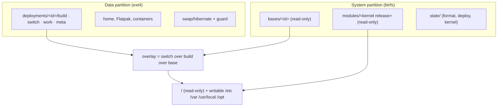
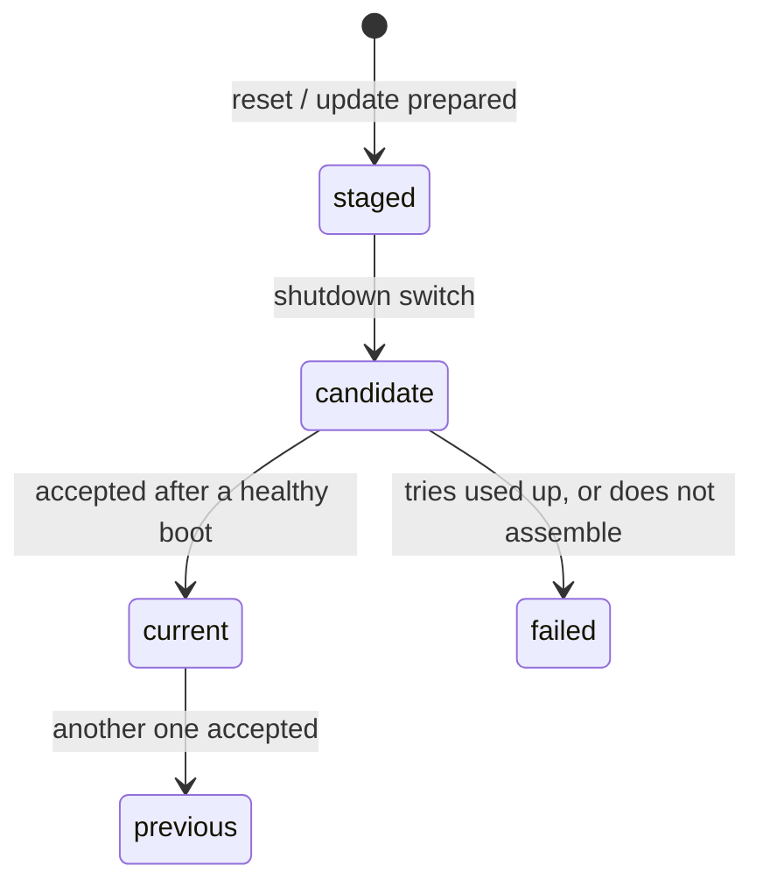

# Root file system and deployments

How GlassineOS builds its root file system, how updates and resets work, and how a
failed update falls back. The decision and its reasons are in
[0010](../decisions/0010-root-and-deployments.md). The formats and the command
interface live in the `boot` repository, in `docs/deployments.md`, which is the
reference for anything that reads or writes them.

!!! warning "Status"
    The deployment model, the boot steps, reset, the shutdown switch and the
    boot-success service are built and host-tested: on real btrfs, ext4 and overlayfs
    on the host kernel, and end to end in QEMU (the real initramfs and init system,
    including a switch at a real shutdown and a real resume from hibernation;
    2026-10-29). On hardware (Note Air, 2026-10-31 to 2026-11-01): an existing install
    migrated, deployments boot and are accepted, a base update arrived as an
    incremental stream, and live packages were replayed onto a new base across an
    Alpine branch change. Rollback and reset are untested on hardware. Signed streams
    from CI and the kernel hand-off are not built yet.

## Purpose

- No update or edit can leave the device without a bootable system.
- Every new system is tried before it counts, with an automatic way back.
- "Reset the system" without a reinstall, keeping the user's settings if asked to.
- Packages install the normal Alpine way, without a rebuild or a reboot.
- The same tool works in the running system and in the recovery.

## Design

### Storage

- A **base** is a complete system and never changes. New bases arrive as btrfs send
  streams from CI, or are built on the device.
- A **deployment** is a base plus its own layers on the data partition. The build layer
  holds what was prepared for it and is read-only once it exists. The switch layer is
  written at the shutdown switch and then becomes the live upper, where every runtime
  write of that deployment lands.
- **Locked** (the default): `/` is a read-only view of the overlay. `/etc`, `/var`,
  `/usr/local` and `/opt` are writable views of the same overlay, so tools that replace
  files by rename (`passwd`, time zone links) just work, and the base stays untouched.
- **Home** and app data live on the data partition outside the deployments, and no
  reset touches them.

### Which deployment boots

The state on the system partition names `current`, `previous`, an optional
`candidate` with a number of tries, and an optional `staged` deployment.

At boot, a candidate with tries left uses one and boots. One with none left, or one
that does not assemble, is marked failed, and current boots in the same boot. Then
previous. Without a usable data partition, the base boots with a temporary upper,
keeping nothing. A staged deployment never boots.

### Boot steps

The initramfs ([Boot flow](boot-flow.md)) runs these in the deployments layout:

1. **Hibernation first.** Before any check or read-write mount, a hibernated session is
   resumed if nothing touched the data partition since, the same kernel build is
   running, and the state boots the same deployment. Otherwise the image is cancelled.
   The data partition is only read without mounting until then.
2. **Mount and pick.** The system partition and the data partition are mounted, the
   deployment is picked (one try used), and its root is assembled with the modules for
   the running kernel.
3. **Hand over.** The mounts are moved to `/run/glassine/` in the new root, the booted
   deployment is recorded there, and the init system starts.

### Reset and the shutdown switch

A reset or update only **stages** a deployment. The switch runs at a shutdown or reboot
that the user started, with the charger connected or enough battery. It runs after the
other services have stopped:

1. A fresh switch layer is created for the staged deployment.
2. The persistent state is copied into it from the running system (modes and owners
   kept): the migrate list, and with updates also `/var/lib`. The migrate list is the
   base's own list plus the user's additions.
3. Only then does the deployment become the candidate for the next boot.

Interrupted at any point, nothing is selected and the old deployment boots unchanged.
The next shutdown redoes the switch from scratch. "Reset system" carries the migrate
list; the full reset carries nothing (home and Flatpak's system data stay). In the
recovery, where nothing runs in between, a reset switches at once.

A hibernate never runs the switch: the kernel powers off by itself.

### Clean-up

Nothing has to be removed by hand: deployments, bases and kernel module sets that nothing
can boot go by themselves.

- **Deployments** go after a switch, after an accept, and before a reset or update makes
  a new one. Current, candidate, staged, the last failed one and the booted one stay, and
  so does any deployment that is mounted. Of the earlier deployments, the most recent ones
  stay up to the device's `keep_updates` (its description: 1 on the Note Air, where a
  deployment can cost over a gigabyte of the data partition; 4 on a PC), the previous one
  always among them. A deployment can be pinned to stay. When an update needs more room
  on either partition, the kept earlier deployments other than the previous one and the
  pinned ones go, but only if removing all of them gives the room; otherwise none goes.
- **Bases** go at the same points, after the deployments: a base stays as long as any
  remaining deployment names it, so how many bases stay follows from the deployments
  (the current one and the one to fall back to). A mounted base stays too. While a
  deployment's record can't be read, or a hibernated session's base can't be told,
  nothing is removed: unreadable never counts as unused.
- **Kernel module sets** go at the same points: a set stays while any kernel that can
  still start uses it (the running kernel, the ones the kernel records name, the kernel
  in the boot partition or slot the device starts from, a hibernated session's kernel)
  or it was received since this start. If any of these can't be read, nothing is
  removed.
- **A new base that doesn't fit** makes the receive remove the unused bases first (never
  the parent of an incremental stream), and try once more if the partition still runs
  out of space. If it still doesn't fit, the receive stops with the space needed and the
  space free, and nothing is kept.

The system partition is sized for one complete base and a few incremental updates, so
updates should arrive as incremental streams: a full stream per update fills it after a
handful.

**Verified on hardware** Note Air · 2026-11-21 (a base removed after a stage and after an accept) · 2026-11-28 (15 unused module sets removed after an accept, the running kernel's kept)
{ .gl-verified }

**From source** keeping more than one earlier deployment, pins, and the room rule: tested in the boot repository's tests and on virtual PCs, untested on hardware
{ .gl-untested }

### Recovery

The GlassineOS recovery ([0007](../decisions/0007-recovery-mainline-twrp.md)) calls the same `glassine-deploy` tool through its menu: status,
list, select a deployment, roll back, reset. It cancels a hibernated session (after
asking) before it writes anything.

## Interfaces

| Interface | Owner | What |
|---|---|---|
| `glassine-deploy` commands, porcelain output, exit codes | `boot` (`docs/deployments.md`) | for the recovery menu, packages, settings |
| `state/` files and their format version | `boot` | read by the initramfs, the tool and later the loader |
| `/etc/glassine/deploy.conf` | device package | where the partitions are, battery threshold for the switch |
| migrate lists: `/usr/share/glassine/migrate.list`, `/etc/glassine/migrate.d/*.list` | base / user | what a switch carries |
| `/run/glassine/booted` | initramfs | the booted deployment, for acceptance and hibernation |
| `glassine-switch-hook --user-shutdown` | `boot` → shell's power menu | marks a shutdown the user started |
| hibernation guard file | `boot` (format) → hibernate step | what must match for a resume |

## Open questions

- **Hardware:** rollback and reset on a device.
- **Base streams:** CI publishing and signing. Until then the person's computer builds
  them ([0013](../decisions/0013-images-from-dockerfile-stages.md)).
- **The kernel hand-off**, one method per device
  ([0010](../decisions/0010-root-and-deployments.md)), and with it kernel updates.
