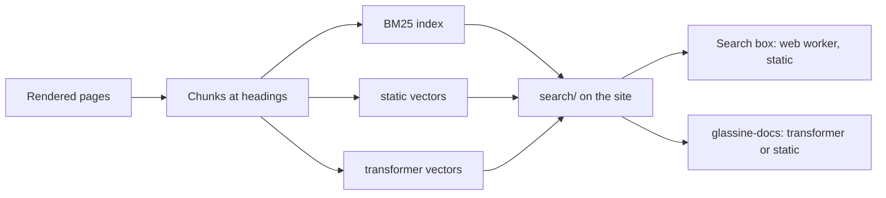

# Search

How the search on this site and the `glassine-docs` command find text by keywords and
by meaning. The decision is [0011](../decisions/0011-semantic-search.md); the code and
the file format live in [GlassineOS/search](https://github.com/GlassineOS/search).

## Purpose

- Find a passage when the reader's words differ from the page's words, and still find
  exact terms such as `boot_b` or `mmcblk0p48`.
- Give coding agents and the device's tools the same search, with links they can cite.
- Stay cheap: no server, a few MB for a reader who searches, nothing for one who
  doesn't, and offline use from a cache.

## Design



**Build.** The docs build runs the MkDocs plugin `glassine-search`. It splits every
rendered page at its headings; a chunk's ID names its source, commit, page and heading
anchor (`docs@<commit>:guides/qualcomm-boot-and-edl.md#3-enter-edl`). It then builds a
BM25 keyword index and embeds each chunk twice:

| Profile | Model | Vectors | Used by |
|---|---|---|---|
| `static` | potion-base-8M (MIT): token lookup and average, as an int8 table | 256 sign bits + int8 copy | the site, the device's tools |
| `transformer` | bge-small-en-v1.5 (MIT), int8 ONNX | 384 int8 | coding agents |

The browser, the command and the build all embed with the same int8 table of the
static model, so a query and a chunk are embedded by the same arithmetic. The build
re-embeds only chunks whose text changed. Models are pinned by sha256 and downloaded
from a release of GlassineOS/search.

**Ranking.** BM25 and vector search each rank all chunks; reciprocal rank fusion
(`1 / (60 + rank)`, summed) merges the two lists. The static profile first picks the
100 nearest chunks by their sign bits, then rescores those with the int8 vectors.

**Site.** Pages load only a few inline lines. The first focus on, or key in, the
search box loads the search script, which starts a web worker with the static model
(8 MB, once per model change) and the index. The theme's keyword results show at once;
when the worker is ready, its fused results replace them in the same panel. Each page
ends with related pages, computed in the build from the static vectors.

**Command.** `glassine-docs search "<query>"` checks the site's `manifest.json` with
its ETag, downloads only files whose hash changed, and keeps everything in
`~/.cache/glassine/docs-search/`.

## Interfaces

- `https://docs.glassine.org/search/manifest.json` and the files it names: format
  version 1, specified in the search repository's `docs/format.md`.
- The command:

```sh
pip install "git+https://github.com/GlassineOS/search"
glassine-docs search "how do I get back into recovery" [--profile transformer|static] [-k N] [--json]
```

- The plugin's settings in `mkdocs.yml` (`related_profile`, `related_count`).

## Open questions

- The static model is 8 MB, most of it the int8 table; a 4-bit table would halve it.
- The index holds this site only. Other repositories' documentation can join it as
  further sources (the manifest's source list and the chunk IDs allow it).
- Search quality is checked by hand on a few queries; there is no test set yet.
